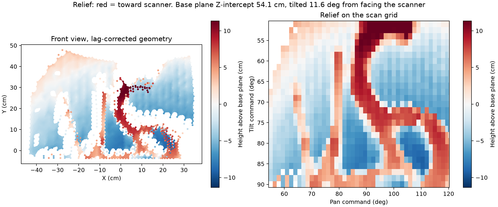

<<<<<<< Updated upstream
# Dual-Servo 3D Scanner

A dual-servo scanner using an infrared distance sensor to build depth maps, relief images, and 3D models.

## 1. Setup & Installation

### Requirements

- macOS
- Python 3.12  
  Python 3.12 is required for Taichi compatibility.
- VS Code
- PlatformIO IDE extension for VS Code
- Arduino Uno connected via USB

### Step 1: Open the Project Directory

Open Terminal in the project directory, then run:

```bash
cd Final_PIE_2
```

### Step 2: Create a Python 3.12 Virtual Environment

```bash
python3.12 -m venv .venv
```

Activate the virtual environment:

```bash
source .venv/bin/activate
```

After activation, your terminal should show something similar to:

```text
(.venv)
```

### Step 3: Install Required Python Packages

```bash
python -m pip install -r requirements-lock.txt
```

## 2. Flash Arduino Firmware

1. Open the project folder in VS Code.
2. Connect the Arduino Uno to your Mac using USB.
3. Make sure the PlatformIO IDE extension is installed.
4. Upload the firmware.

You can upload directly from VS Code by clicking the **Upload (`→`)** button in the bottom status bar.

Alternatively, run:

```bash
pio run --target upload
```

## 3. Run the Scanner

### Step A: Find the Arduino Serial Port

Run:

```bash
python python/scanner.py ports
```

Find the port corresponding to the Arduino.

On macOS, it will usually look similar to:

```text
/dev/cu.usbmodemXXXX
```

For example:

```text
/dev/cu.usbmodem1101
```

### Step B: Start Scanning

Place the object approximately **25–35 cm** in front of the scanner.

Run:

```bash
python python/scanner.py scan --port YOUR_PORT_HERE
```

For example:

```bash
python python/scanner.py scan --port /dev/cu.usbmodem1101
```

A full scan takes approximately **8.5 minutes**.

To stop the scan at any time, press:

```text
Ctrl+C
```

The Python program will send a stop command to the Arduino and attempt to release the servos safely.

## 4. Results

Each scan creates a new output directory:

```text
output/scan_DATE_TIME/
```

For example:

```text
output/scan_2026-09-27_04-30-00/
```

The folder contains the reconstructed scan results.

### `relief.png`

Height or relief visualization of the scanned object.

### `depth.png`

Depth map reconstructed from the measured distance data.

### `surface.png`

3D surface visualization generated from the reconstructed scan.

### `surface.ply`

3D triangle mesh model of the scanned surface.

The `.ply` file can be opened in software such as:

- MeshLab
- Blender

## 5. Output Structure

```text
output/
└── scan_DATE_TIME/
    ├── relief.png
    ├── depth.png
    ├── surface.png
    └── surface.ply
```

## 6. Basic Workflow

```text
Infrared Distance Sensor
        |
        | Voltage measurements
        v
Arduino Uno
        |
        | Serial data
        v
Python Scanner
        |
        | Calibration
        | Filtering
        | Reconstruction
        v
Depth Map
        |
        v
Relief Image
        |
        v
3D Surface
        |
        v
Triangle Mesh (.ply)
```

## 7. Typical Usage

```bash
cd Final_PIE_2
source .venv/bin/activate
python python/scanner.py ports
python python/scanner.py scan --port /dev/cu.usbmodem1101
```

After the scan finishes, check:

```text
output/
```

for the generated depth map, relief image, surface visualization, and 3D mesh.
=======
# 3D Scanner

Low-cost pan-tilt IR 3D scanner: Arduino Uno + two servos + a Sharp GP2Y0A IR range sensor,
with a Python pipeline that calibrates the sensor (MLP), estimates servo backlash, self-calibrates
the geometry with Taichi autodiff, and reconstructs a meshed point cloud.

- Project report (results, resume bullets): [English](docs/PROJECT_REPORT.md) · [中文](docs/PROJECT_REPORT_zh.md)
- How it works (principles and math): [docs/PRINCIPLES.md](docs/PRINCIPLES.md)



## Setup

```bash
python3.12 -m venv .venv && .venv/bin/pip install -r requirements.txt
```

Flash the firmware with PlatformIO (`pio run -t upload`). Set `SERIAL_PORT` in
`python/settings.py` (list ports with `python python/scanner.py ports`).

## Usage

All commands run from the repository root with `.venv/bin/python`.

| Step | Command |
|---|---|
| Train the sensor model | `python/train_mlp.py` (`--errors-only` to evaluate the saved model) |
| Scan and reconstruct | `python/scanner.py scan` |
| Rebuild a saved scan | `python/scanner.py reconstruct output/<scan>/raw.csv` |
| Estimate servo backlash | `python/scanner.py backlash output/<scan>/raw.csv --save` |
| Capture a flat board | `python/scanner.py plane --z 45 --output data/planes/board45.csv` |
| Calibrate geometry | `python/scanner.py calibrate data/planes/*.csv` |
| Check on unused boards | `python/scanner.py check data/planes/board60.csv` |
| Measure sensor noise | `python/scanner.py noise` |
| Release the servos | `python/scanner.py stop` |

Add `--no-show` to skip plot windows. Results go to `output/`.

## Tests

```bash
.venv/bin/python -m unittest tests/test_pipeline.py
```
>>>>>>> Stashed changes
